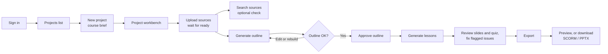

# UI user flow

Last updated 22 September 2026, against the single-pass baseline.

## Overview

LMS Studio turns source documents into a course: you upload files, approve a generated course plan, generate a slide deck and quiz per lesson, then export an editable PPTX and a SCORM 1.2 package. This guide walks a new user through every screen in that order.

Who sees what depends on the account role:

| Role | Lands on after sign-in | Left-rail items |
| --- | --- | --- |
| Instructor | Projects | Projects, Jobs, Learn |
| Admin | Projects | Projects, Jobs, Learn, Users, Prompts |
| Learner | Learn | Learn |

The left rail is icon-only; hover an icon to see its name. The bottom of the rail holds the light/dark theme toggle and Sign out.

## Before you start

The app runs locally in Docker; once it is up, open http://localhost:3000 and sign in.

1. Install Git and Docker Desktop (Linux containers), and start Docker.
2. From the repository root on Windows PowerShell, run:
    - `powershell -ExecutionPolicy Bypass -File scripts/setup.ps1`
    - `powershell -ExecutionPolicy Bypass -File scripts/compose.ps1 up --build --wait`
3. On macOS or Linux, use `sh scripts/setup.sh` then `sh scripts/compose.sh up --build --wait`.
4. Complete the model preparation steps in [ONBOARDING.md](ONBOARDING.md#prepare-models-and-check-document-search). A healthy app does not mean model weights are cached, and search and generation need them.
5. Open http://localhost:3000. Sign in with `DEFAULT_ADMIN_EMAIL` and `DEFAULT_ADMIN_PASSWORD` from your generated `.env`.

If you visit any page while signed out, or your session has expired, you are sent to the sign-in page. After signing in you return to the page you asked for.

To skip ahead and see a finished course, run `sh scripts/compose.sh exec -T api python /srv/scripts/course_baseline.py --keep`. It builds a full course in 15–30 minutes on a CPU laptop and leaves it in the UI.

## Flow map

An instructor's path is sign in, create a project, upload sources, then build the course in the **Outline**, **Lessons** and **Publish** tabs.

The centre of the workbench has one tab per stage: **Sources**, **Outline**, **Lessons** and **Publish**. Each tab's badge shows its stage's state, such as `v2 draft`, `6 flags` or `exported 28 Oct`.

## Step-by-step walkthrough

Follow these steps in order the first time. Use a window at least 1024 px wide: below that, the Sources and Inspector panes are hidden.

### 1. Sign in

1. Enter the email and password your admin gave you, then click **Sign in**.
2. Instructors and admins land on **Projects**; learners land on **Learn**.

### 2. Create a project

1. On **Projects**, click **New project** (top right). A **Course brief** card opens.
2. Fill in **Project name** (required), **Target audience**, **Duration (minutes)** and **Learning goals**. The planner uses all three to shape objectives and lessons.
3. Click **Create**. The project appears as a card showing its source count and last update.
4. Click the card to open the project workbench.

### 3. Learn the workbench layout

The workbench has three panes:

| Area | What it holds |
| --- | --- |
| Left pane: Sources | Uploaded files, their status, and view, re-ingest and delete buttons |
| Centre: stage tabs | **Sources** (knowledge-base search and the file viewer), **Outline**, **Lessons**, **Publish** |
| Right pane: Inspector | The course brief, or details of a selected passage |

### 4. Upload sources

1. In the **Sources** pane, click **Add** and pick one or more PDF, DOCX, PPTX, Markdown or text files.
2. Each file shows a status badge and a progress bar while it is processed: **uploaded → parsing → parsed → embedding → ready**.
3. When a file is **ready**, its line shows size, page count and chunk count.
4. Click a file's name or the eye icon to view it: PDFs as uploaded, Word and PowerPoint files as a PDF rendering, text as text.
5. Use the refresh icon to re-ingest a file, or the bin icon to delete it. If the course uses the file, you choose between keeping the course as it is and rebuilding the outline without it.

Course planning unlocks once at least one source is **ready**.

### 5. Check what the model can see (optional)

1. On the **Sources** tab, type a question into **Ask the sources…** and click **Search**.
2. Results list the source, section, page and a similarity score.
3. Click a result to see the full passage and its provenance in the **Inspector**.

If nothing comes back, the message reads "No chunks above the similarity threshold"; try other wording or add sources.

## Course generation and export

The course has three stage tabs after **Sources**. Each has one highlighted button for its next step. You can switch tabs while a run is going: progress keeps updating.

### Outline

The outline is the course plan: modules, lessons and the objectives each lesson teaches.

1. Click **Generate outline**. You can add instructions first, such as "keep it to four lessons".
2. Review it. Each lesson row shows its objective, its length and its state (`not generated`, `3 flagged`, `approved`).
3. Fix small things directly. Click a title to rename it. Hover a lesson to move it up or down, or to remove it. Use **Add lesson** under a module.
4. To change the structure wholesale, click **Rebuild outline…**, say what should change, and run it. This creates the next version as a draft.
5. Click **Approve outline**. Lessons are generated only from an approved outline.

Editing an approved outline creates a new draft version and keeps every lesson's content. Approve the new version to work on its lessons. Use the version menu to look at an earlier version, and **What changed** to compare a version with the one before it.

### Lessons

The lesson list sits beside the open lesson.

1. Click **Generate all lessons** the first time. Allow a few minutes per lesson on a laptop.
2. Click a lesson to read it. Numbered chips such as **1** are citations: click one to see the source passage in the **Inspector**.
3. Reviewer flags appear on the slide or question they concern. A slide with a flag has a **Fix** button; a lesson with flags has **Fix N flagged**. A fix comes back as a proposed change.
4. Proposed changes show what leaves and what arrives. Click **Accept** or **Keep original** on each, or **Accept all**.
5. Hover a slide or question to **Regenerate** it or **Edit** it in place. **Regenerate lesson…** rewrites the whole lesson at once. Every regeneration panel takes optional instructions and quick changes such as **Simpler language**.
6. **History** lists every earlier version of the lesson; **Restore** brings one back.
7. Click **Approve lesson** when it is ready. Approved lessons cannot change until you click **Reopen**.

Tick several lessons to fix, regenerate or approve them together.

### Publish

1. The checklist shows what is still open: unapproved outline, ungenerated or unapproved lessons, open flags and waiting changes. None of these block an export.
2. Click **Export PowerPoint and SCORM**. Each export appears as a row with its date and outline version.
3. Click **Preview** to play the SCORM package in the browser as a learner would, **SCORM** to download `course_scorm12.zip`, or **PPTX** to download `course.pptx`.

## Status, errors and troubleshooting

Most problems show as a red badge or a red line of text; the **Jobs** page shows every background run from the last 2 hours.

| What you see | What it means | What to do |
| --- | --- | --- |
| Sources and Inspector panes missing | Window is narrower than 1024 px | Widen the window |
| Source badge **failed** with red text under it | Parsing or embedding failed | Read the error, then click re-ingest; delete and re-upload if it fails again |
| Project card shows **failed** | At least one of its sources failed | Open the project and fix that source |
| **Generate outline** greyed out | No source is ready yet | Wait for a source to reach **ready** |
| **Lessons** tab asks you to review the outline | The latest outline is not approved | Approve it on the **Outline** tab |
| **Export PowerPoint and SCORM** greyed out | No lessons generated yet | Generate lessons first |
| Regenerate and Edit missing on a lesson | The lesson is approved | Click **Reopen** |
| "Queued — waiting for the worker" does not move | The worker container is not running | Check `docker compose ps`; restart the stack |
| A red message at the top of a tab | That run or change failed | Read it; check the full message on **Jobs** and retry |
| Summary lists uncited bullets or broken citations | Baseline output quality, not a crash | Review those slides before sharing the export |
| Sent back to sign-in | Session expired | Sign in again; you return to the same page |

### Jobs page

Click **Jobs** in the left rail to see every run: what it worked on (such as the file being ingested), its course, status, progress, message and age. It refreshes every 3 seconds. Click **Cancel** on a pending or running job to stop it.

### Admin screens

- **Users**: click **Add user**, enter name, email, a temporary password (at least 10 characters), role and optional org unit, then **Create**. Use **Deactivate** to disable an account.
- **Prompts**: pick a task (critique, quiz, plan, slides) at the top right. Click **Fork active** or a version name to edit a copy, then **Save as new version**. New versions start inactive; click **Activate** to use one.

### Learn page

**Learn** is a placeholder today. Approved courses will appear there as an in-browser preview in a later milestone (M4).

## Glossary

| Term | Meaning in the UI |
| --- | --- |
| Project | One course being built: its brief, sources, plan, lessons and exports |
| Course brief | Audience, duration and goals entered when creating a project |
| Source | An uploaded document (PDF, DOCX, PPTX, Markdown, text) |
| Chunk | A searchable slice of a source; every citation points to one |
| Knowledge base | All ready chunks in a project, searchable on the Sources tab |
| Similarity | How closely a chunk matches your search, from 0 to 1 |
| Plan | Objectives, modules and lessons generated from the sources; versioned (v1, v2…) |
| Bloom level | The cognitive level of an objective, such as remember or apply |
| Coverage | Share of each source's excerpts the plan drew on |
| Citation chip | A numbered marker on a slide; click it to see the cited passage |
| Inspector | Right pane showing a passage's source, section, pages and text |
| Job | A background run (ingest, plan, lessons, export) listed on the Jobs page |
| SCORM 1.2 | A standard zip package that most LMSs can import |
| Baseline | The current single-pass generation, with no critique or revision yet |
