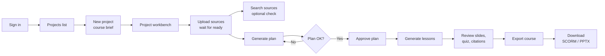

# UI user flow

Last updated 22 September 2026, against the single-pass baseline.

## Overview

LMS Studio turns source documents into a course: you upload files, approve a generated course plan, generate a slide deck and quiz per lesson, then export an editable PPTX and a SCORM 1.2 package. This guide walks a new user through every screen in that order.

Who sees what depends on the account role:

| Role | Lands on after sign-in | Left-rail items |
| --- | --- | --- |
| Instructor | Projects | Projects, Jobs, Learn |
| Admin | Projects | Projects, Jobs, Learn, Users, Prompts |
| Learner | Learn | Learn |

The left rail is icon-only; hover an icon to see its name. The bottom of the rail holds the light/dark theme toggle and Sign out.

## Before you start

The app runs locally in Docker; once it is up, open http://localhost:3000 and sign in.

1. Install Git and Docker Desktop (Linux containers), and start Docker.
2. From the repository root on Windows PowerShell, run:
    - `powershell -ExecutionPolicy Bypass -File scripts/setup.ps1`
    - `powershell -ExecutionPolicy Bypass -File scripts/compose.ps1 up --build --wait`
3. On macOS or Linux, use `sh scripts/setup.sh` then `sh scripts/compose.sh up --build --wait`.
4. Complete the model preparation steps in [ONBOARDING.md](ONBOARDING.md#prepare-models-and-check-document-search). A healthy app does not mean model weights are cached, and search and generation need them.
5. Open http://localhost:3000. Sign in with `DEFAULT_ADMIN_EMAIL` and `DEFAULT_ADMIN_PASSWORD` from your generated `.env`.

If you visit any page while signed out, or your session has expired, you are sent to the sign-in page. After signing in you return to the page you asked for.

To skip ahead and see a finished course, run `sh scripts/compose.sh exec -T api python /srv/scripts/course_baseline.py --keep`. It builds a full course in 15–30 minutes on a CPU laptop and leaves it in the UI.

## Flow map

An instructor's path is sign in, create a project, upload sources, then plan, approve, generate and export from the Course tab.

The stepper at the top right of the workbench tracks the same four stages: **1 Ingest → 2 Plan → 3 Generate → 4 Export**. The current stage is highlighted and finished stages turn green.

## Step-by-step walkthrough

Follow these steps in order the first time. Use a window at least 1024 px wide: below that, the Sources and Inspector panes are hidden.

### 1. Sign in

1. Enter the email and password your admin gave you, then click **Sign in**.
2. Instructors and admins land on **Projects**; learners land on **Learn**.

### 2. Create a project

1. On **Projects**, click **New project** (top right). A **Course brief** card opens.
2. Fill in **Project name** (required), **Target audience**, **Duration (minutes)** and **Learning goals**. The planner uses all three to shape objectives and lessons.
3. Click **Create**. The project appears as a card showing its source count and last update.
4. Click the card to open the project workbench.

### 3. Learn the workbench layout

The workbench has three panes and a stepper:

| Area | What it holds |
| --- | --- |
| Top bar | Project name, and the Ingest → Plan → Generate → Export stepper |
| Left pane: Sources | Uploaded files, their status, re-ingest and delete buttons |
| Centre: Sources / Course tabs | Knowledge-base search, or the three course steps |
| Right pane: Inspector | The course brief, or details of a selected passage |

### 4. Upload sources

1. In the **Sources** pane, click **Add** and pick one or more PDF, DOCX, PPTX, Markdown or text files.
2. Each file shows a status badge and a progress bar while it is processed: **uploaded → parsing → parsed → embedding → ready**.
3. When a file is **ready**, its line shows size, page count and chunk count.
4. Use the refresh icon to re-ingest a file, or the bin icon to delete it (you are asked to confirm).

Course planning unlocks once at least one source is **ready**.

### 5. Check what the model can see (optional)

1. On the **Sources** tab, type a question into **Ask the sources…** and click **Search**.
2. Results list the source, section, page and a similarity score.
3. Click a result to see the full passage and its provenance in the **Inspector**.

If nothing comes back, the message reads "No chunks above the similarity threshold"; try other wording or add sources.

## Course generation and export

Open the **Course** tab in the workbench centre. It shows three numbered step cards; each unlocks when the one before it is done. You can switch tabs while a step runs: progress keeps updating.

### Step 1: Plan the course

1. Click **Generate plan**. A progress bar and status message appear under the card.
2. When it finishes, the card shows the plan: title, summary, version (for example `v1`) and a status badge.
3. Review the parts of the plan:
    - **Learning objectives**, each with an ID and a Bloom level.
    - **Modules** and their **lessons**, each with minutes, linked objectives and a source count.
    - **Coverage**: the share of each source's excerpts the plan drew on.
4. Read the summary line under the card, such as lesson count, model calls, time taken and any lessons with no linked source.
5. Not happy? Click **New version** to regenerate. Happy? Click **Approve plan**. Lessons are generated only from an approved plan.

### Step 2: Generate lessons

1. Click **Generate lessons**. Allow a few minutes per lesson on a laptop.
2. The summary line reports decks, slides, accepted and rejected quiz questions, and uncited bullets.
3. Back in the plan, lesson rows now show slide and question counts and become clickable.
4. Click a lesson to open it:
    - Each slide shows its title, bullets, any table, and speaker notes.
    - Numbered chips such as **1** are citations. Click one to see the source passage in the **Inspector**.
    - The **Quiz** lists kept questions with the correct answer in green, an explanation, and a **source** quote you can click.
5. Click **← Course** to return to the step cards.

Use **Regenerate** to rebuild every lesson from the current approved plan.

### Step 3: Export

1. Click **Export course**.
2. Each export appears as a row with its date and plan version.
3. Click **SCORM** to download `course_scorm12.zip`, a SCORM 1.2 package with one SCO per lesson for your LMS.
4. Click **PPTX** to download `course.pptx`, an editable PowerPoint.

A row marked **unreviewed content** includes material that has not been approved. When the export finishes, all four stepper stages turn green.

## Status, errors and troubleshooting

Most problems show as a red badge or a red line of text; the **Jobs** page shows every background run from the last 2 hours.

| What you see | What it means | What to do |
| --- | --- | --- |
| Sources and Inspector panes missing | Window is narrower than 1024 px | Widen the window |
| Source badge **failed** with red text under it | Parsing or embedding failed | Read the error, then click re-ingest; delete and re-upload if it fails again |
| Project card shows **failed** | At least one of its sources failed | Open the project and fix that source |
| **Generate plan** greyed out, "Waiting for at least one source…" | No source is ready yet | Wait for a source to reach **ready** |
| **Generate lessons** greyed out | Plan not approved, or a plan run is active | Approve the plan, or wait for the run |
| **Export course** greyed out | No lessons generated yet | Run Step 2 first |
| Lesson row not clickable | That lesson has no slides or quiz yet | Run or rerun **Generate lessons** |
| "Queued — waiting for the worker" does not move | The worker container is not running | Check `docker compose ps`; restart the stack |
| "Failed: …" under a step card | That run errored | Read the first line; check the full message on **Jobs** and retry |
| Summary lists uncited bullets or broken citations | Baseline output quality, not a crash | Review those slides before sharing the export |
| Sent back to sign-in | Session expired | Sign in again; you return to the same page |

### Jobs page

Click **Jobs** in the left rail to see every run: kind, status, progress, message and age. It refreshes every 3 seconds. Click **Cancel** on a pending or running job to stop it.

### Admin screens

- **Users**: click **Add user**, enter name, email, a temporary password (at least 10 characters), role and optional org unit, then **Create**. Use **Deactivate** to disable an account.
- **Prompts**: pick a task (critique, quiz, plan, slides) at the top right. Click **Fork active** or a version name to edit a copy, then **Save as new version**. New versions start inactive; click **Activate** to use one.

### Learn page

**Learn** is a placeholder today. Approved courses will appear there as an in-browser preview in a later milestone (M4).

## Glossary

| Term | Meaning in the UI |
| --- | --- |
| Project | One course being built: its brief, sources, plan, lessons and exports |
| Course brief | Audience, duration and goals entered when creating a project |
| Source | An uploaded document (PDF, DOCX, PPTX, Markdown, text) |
| Chunk | A searchable slice of a source; every citation points to one |
| Knowledge base | All ready chunks in a project, searchable on the Sources tab |
| Similarity | How closely a chunk matches your search, from 0 to 1 |
| Plan | Objectives, modules and lessons generated from the sources; versioned (v1, v2…) |
| Bloom level | The cognitive level of an objective, such as remember or apply |
| Coverage | Share of each source's excerpts the plan drew on |
| Citation chip | A numbered marker on a slide; click it to see the cited passage |
| Inspector | Right pane showing a passage's source, section, pages and text |
| Job | A background run (ingest, plan, lessons, export) listed on the Jobs page |
| SCORM 1.2 | A standard zip package that most LMSs can import |
| Baseline | The current single-pass generation, with no critique or revision yet |
